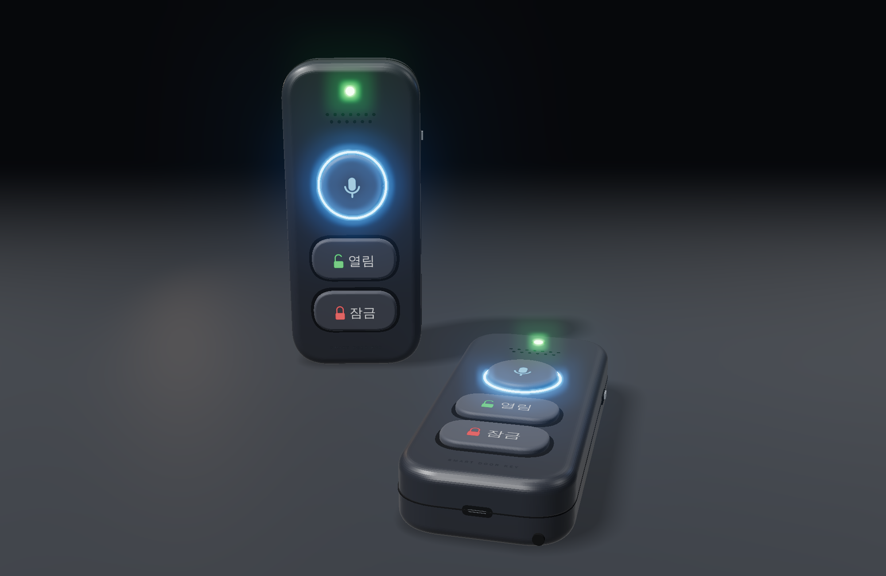
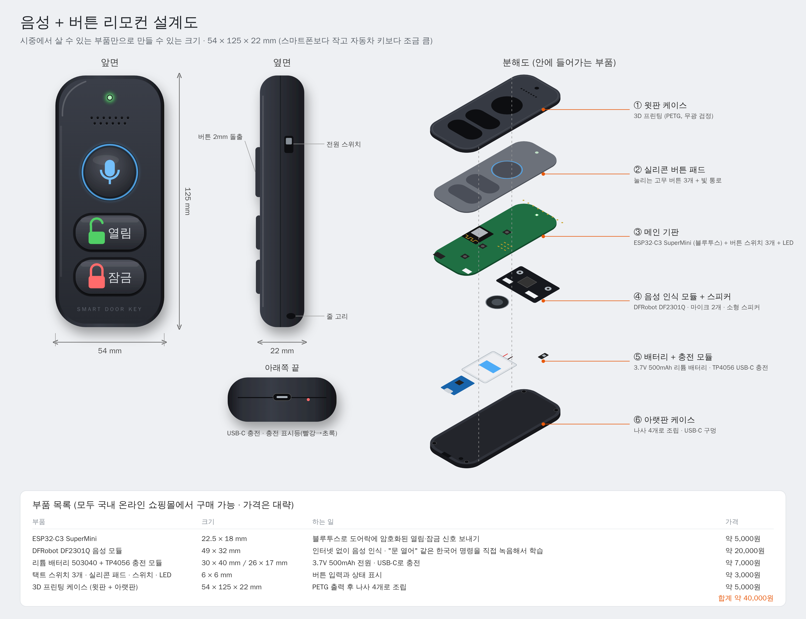
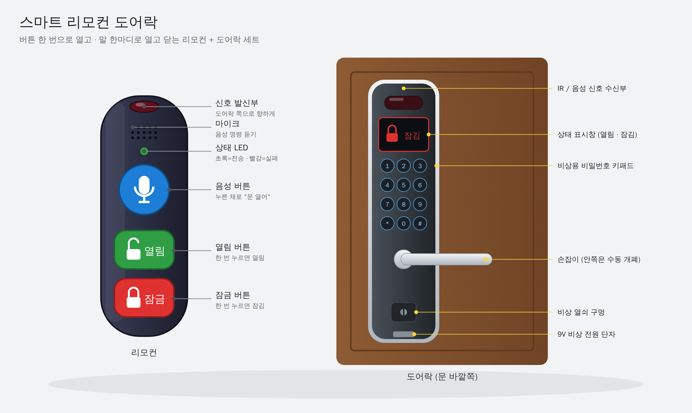
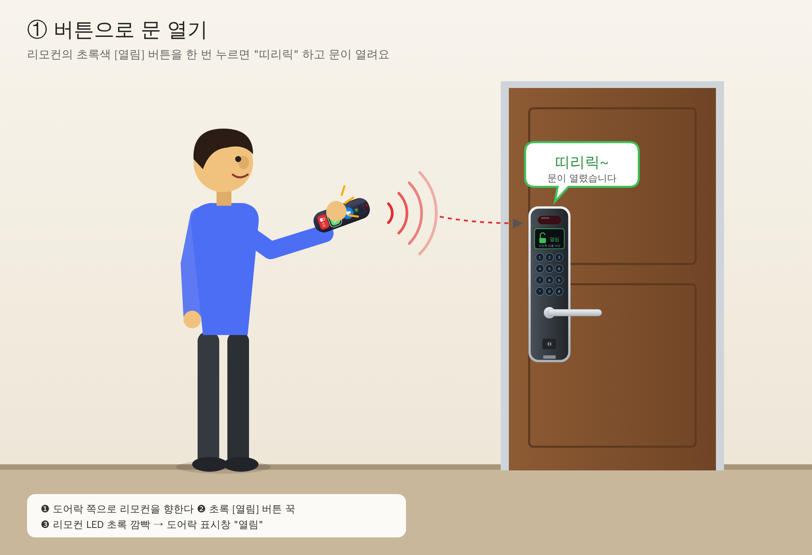
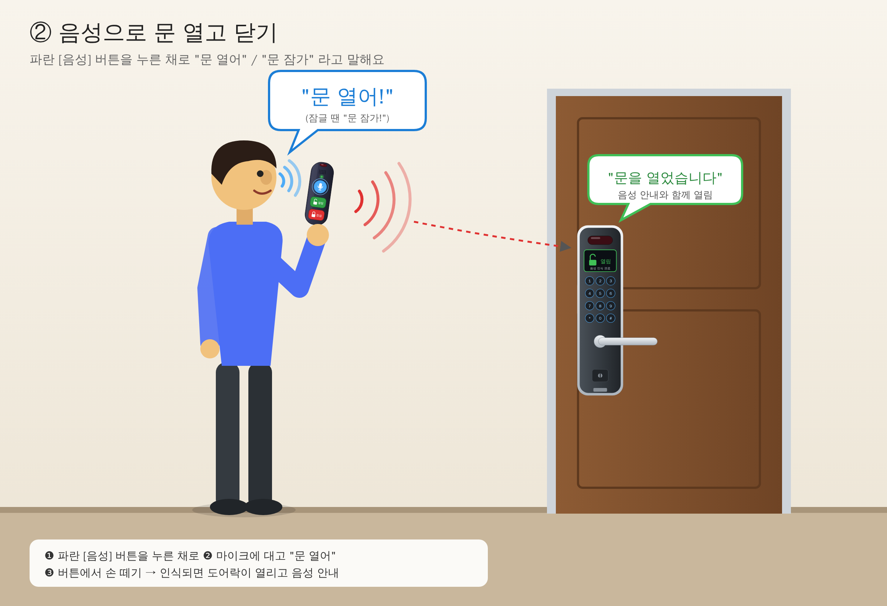
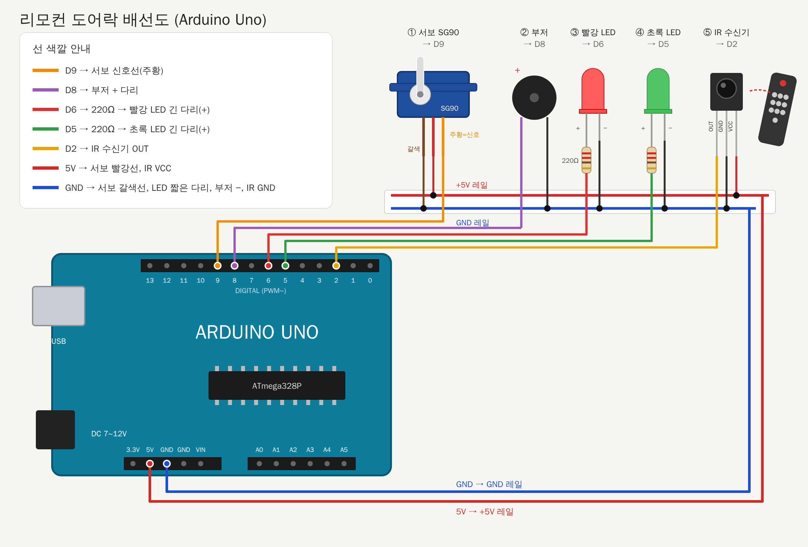
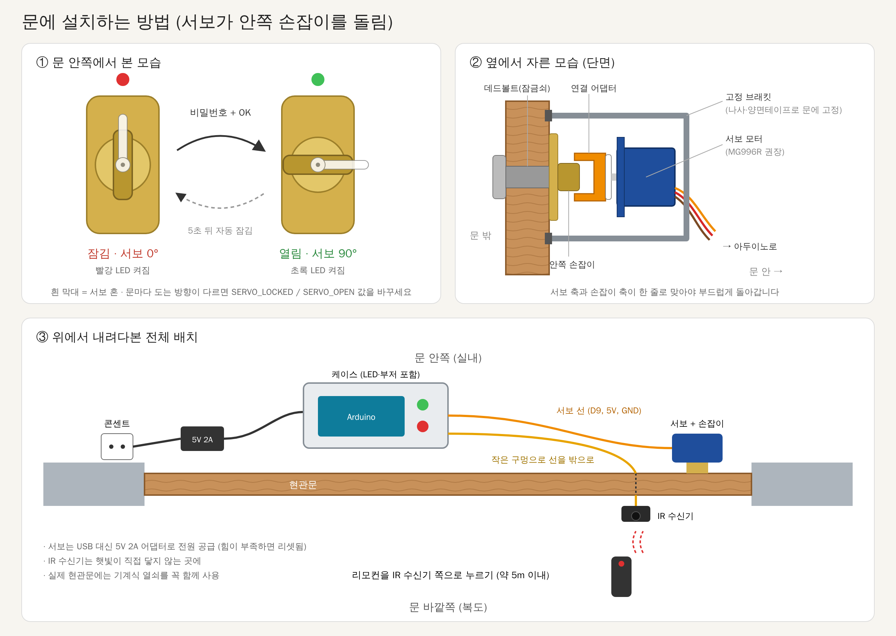
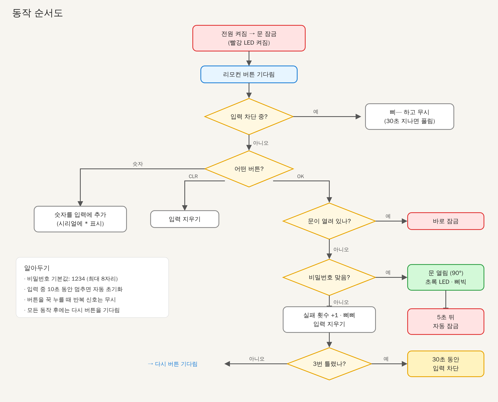

# Minsung

## 리모컨으로 도어락 열기 (IR Remote Door Lock)

적외선(IR) 리모컨으로 비밀번호를 입력해 도어락을 여는 아두이노 프로젝트입니다.
코드: [`remote_door_lock/remote_door_lock.ino`](remote_door_lock/remote_door_lock.ino)

### 그림 자료

#### 리모컨 3D 렌더링

> 3D 장면 소스: `docs/3d/` (Three.js)

#### 음성 + 버튼 리모컨 설계도

#### 리모컨 + 도어락 제품 모습

#### 버튼으로 문 열기

#### 음성으로 문 열고 닫기

#### 배선도

#### 문에 설치하는 방법

#### 동작 순서도

> 그림 원본(SVG)은 `docs/` 폴더에 있습니다.

### 준비물

| 부품 | 수량 |
|---|---|
| Arduino Uno | 1 |
| IR 수신 모듈 (VS1838B 등) + IR 리모컨 | 1 |
| 서보 모터 SG90 — 실제 문 손잡이는 힘이 센 MG996R 권장 (또는 릴레이 + 12V 솔레노이드 잠금장치) | 1 |
| 5V 2A 어댑터 (서보 전원용) | 1 |
| LED 초록 / 빨강 + 220Ω 저항 | 각 1 |
| 수동 부저 (선택) | 1 |

### 배선

| 부품 | 아두이노 핀 |
|---|---|
| IR 수신기 OUT / VCC / GND | D2 / 5V / GND |
| 서보 신호(주황) / VCC(빨강) / GND(갈색) | D9 / 5V / GND |
| 초록 LED (열림) | D5 → 220Ω → GND |
| 빨강 LED (잠김) | D6 → 220Ω → GND |
| 부저 | D8 / GND |

> 솔레노이드를 쓸 때는 D9 대신 릴레이 모듈 IN에 연결하고, 솔레노이드는 별도 12V 전원으로 구동하세요.
> 이 경우 코드의 `lockServo.write(...)` 부분을 `digitalWrite(릴레이핀, HIGH/LOW)`로 바꾸면 됩니다.

### 설치

1. Arduino IDE → 라이브러리 매니저에서 **IRremote** (v4.x)를 설치합니다. (`Servo`는 기본 포함)
2. `remote_door_lock.ino`를 열어 업로드합니다.
3. 시리얼 모니터를 **9600bps**로 열고 리모컨 버튼을 눌러 봅니다.
   `[IR] addr=0x0 cmd=0x45` 처럼 출력되는 `cmd` 값을 코드 위쪽 `KEY_0` ~ `KEY_9`, `KEY_OK`, `KEY_CLR`에 적어 넣고 다시 업로드합니다.
   (아두이노 키트에 들어있는 21키 리모컨이면 기본값 그대로 동작합니다.)

### 사용법

- 숫자 버튼으로 비밀번호(기본 `1234`) 입력 → **OK** → 문 열림 (초록 LED, 삐빅)
- 5초 뒤 자동으로 잠김. 열려 있을 때 **OK**를 누르면 바로 잠김
- 입력 중 틀렸다면 **CLR** 버튼으로 지우기
- 3번 틀리면 30초 동안 입력 차단

비밀번호, 자동 잠김 시간, 서보 각도 등은 코드 위쪽 `동작 설정`에서 바꿀 수 있습니다.

### 주의

일반 IR 리모컨 신호는 암호화되지 않아 다른 리모컨으로 쉽게 따라 할 수 있습니다.
그래서 버튼 한 번이 아니라 **비밀번호 + 실패 횟수 제한**을 넣었지만, 실제 현관문보다는
학습용·방문·사물함 같은 용도로 사용하는 것을 권장합니다.
